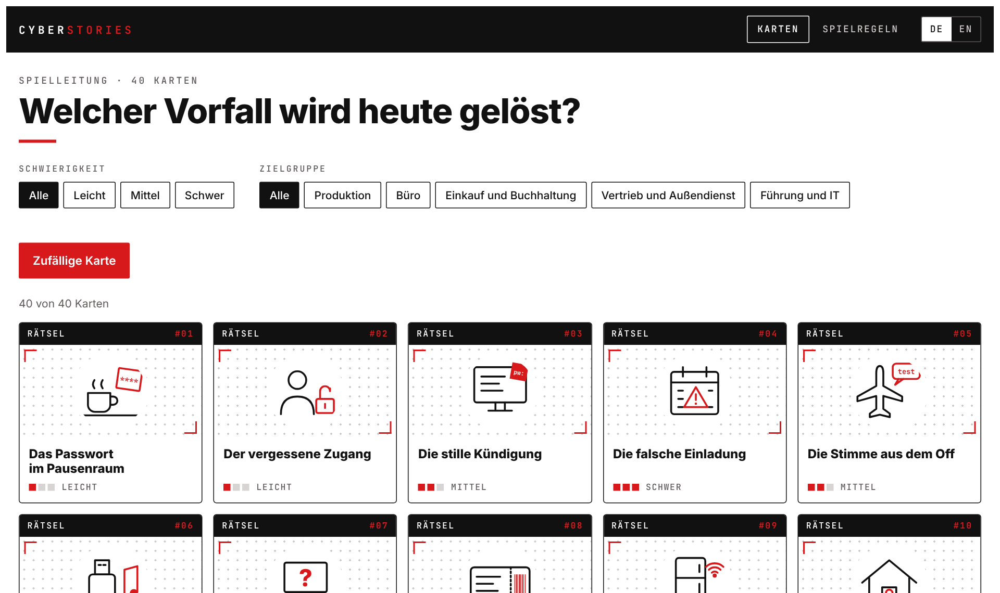
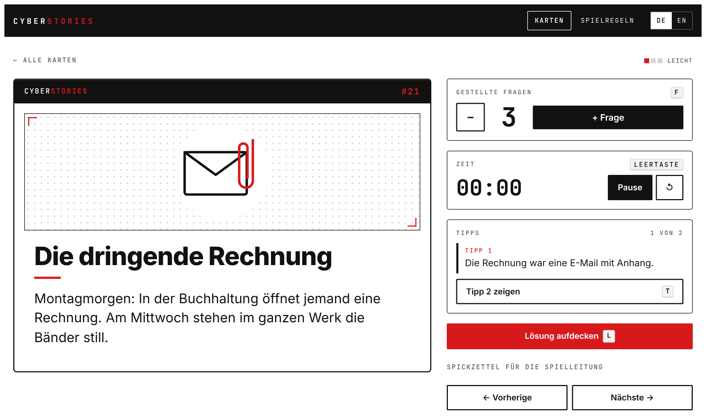
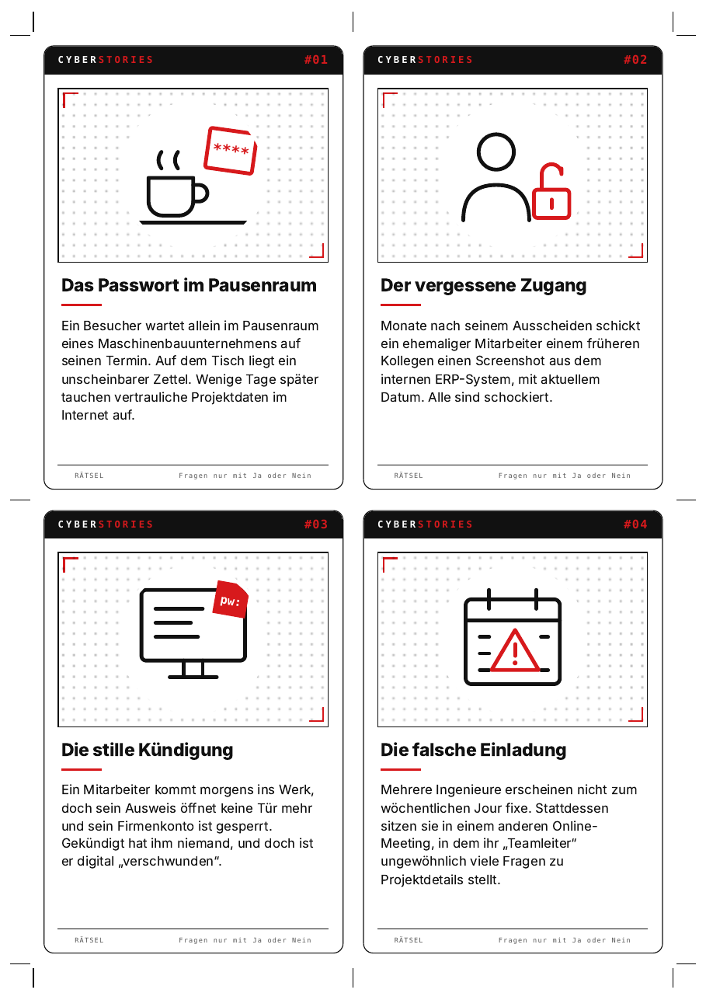

# Cyberstories

**Ein Rätselkartenspiel für Cyber Security Awareness, auf Deutsch und Englisch.**

Cyberstories funktioniert wie das bekannte Black Stories: Jede Karte beschreibt das seltsame Ende eines Sicherheitsvorfalls. Die Spielleitung kennt die Lösung, die Gruppe darf nur Fragen stellen, die sich mit Ja oder Nein beantworten lassen. Stück für Stück kommt heraus, was passiert ist und welcher Fehler es möglich gemacht hat. In der Nachbesprechung geht es dann um die eigentliche Frage: Könnte das bei uns auch passieren?

Das Spiel richtet sich an alle Mitarbeitenden eines Unternehmens, mit und ohne IT-Hintergrund. Die Geschichten spielen überwiegend in einem Maschinenbauunternehmen, sind aber auf jede Branche übertragbar.



## Inhalt

- **40 Karten** mit Rätsel, zwei gestuften Tipps, Lösung und Merksatz, jeweils auf Deutsch und Englisch
- **Webapp für die Spielleitung:** Rätsel groß am Beamer zeigen, Fragen zählen, Zeit stoppen, Tipps und Lösung per Klick aufdecken. Läuft als einzelne HTML-Datei im Browser, ohne Server und ohne Internet. Die Schriften sind eingebettet, die App baut keine externen Verbindungen auf.
- **Druckvorlagen** als PDF zum beidseitigen Drucken und Ausschneiden
- **Spielregeln** auf [Deutsch](docs/Spielregeln.md) und [Englisch](docs/Rules.md)

Die Themen reichen von Phishing, Rechnungsbetrug und Deepfakes über Passwörter, Updates und Datensicherung bis zu Fernwartung in der Produktion, Zutritt zum Gebäude und dem Umgang mit Firmengeräten im Homeoffice. Fünf Karten beruhen auf öffentlich bekannten Vorfällen (Nr. 5, 17, 24, 33 und 38).

## Schnellstart

### Im Browser spielen

[`ausgabe/index.html`](ausgabe/index.html) herunterladen und per Doppelklick öffnen. Oben rechts lässt sich zwischen Deutsch und Englisch umschalten.



**Tastenkürzel in der Spielansicht:** `F` Frage zählen · `T` Tipp zeigen · `L` Lösung aufdecken · `Leertaste` Timer · `←` `→` Karte wechseln

Der Spickzettel im Bedienfeld zeigt der Spielleitung die Lösung vorab. Er sollte nur geöffnet werden, solange der Bildschirm nicht für alle sichtbar ist.

### Karten drucken

- [`ausgabe/Cyberstories_Karten_DE.pdf`](ausgabe/Cyberstories_Karten_DE.pdf) (Deutsch)
- [`ausgabe/Cyberstories_Cards_EN.pdf`](ausgabe/Cyberstories_Cards_EN.pdf) (Englisch)

Beidseitig drucken, Wenden an der langen Kante, in Originalgröße. Die Rückseiten sind bereits passend gespiegelt. An den Schnittmarken ausschneiden, eine Karte ist 95 × 138 mm groß. Am besten zuerst ein Blatt testen, da manche Drucker beim Duplexdruck leicht versetzen.



## Projektstruktur

```
cyberstories/
├── geschichten/          Eine Datei pro Karte (Deutsch und Englisch)
│   ├── _vorlage.md       Vorlage für neue Geschichten
│   └── bilder/           Ein SVG-Motiv pro Karte und ein Platzhalter
├── werkzeug/             Build-Skript, App-Vorlage und Druckvorlage
│   └── schriften/        Eingebettete Schriften mit Lizenzen
├── ausgabe/              Fertige Webapp und Druck-PDFs (werden erzeugt)
└── docs/                 Spielregeln, Anleitung und Screenshots
```

Maßgeblich sind allein die Dateien in `geschichten/`. Alles in `ausgabe/` wird daraus erzeugt und sollte nicht von Hand bearbeitet werden.

## Eine neue Geschichte hinzufügen

1. `geschichten/_vorlage.md` kopieren, zum Beispiel als `geschichten/041-der-falsche-paketbote.md`
2. Kopfbereich ausfüllen und die Texte unter `# Deutsch` und `# English` schreiben
3. Optional ein Motiv als SVG in `geschichten/bilder/` ablegen
4. `python3 werkzeug/bauen.py` ausführen

So sieht eine Geschichten-Datei aus (gekürzt):

```markdown
---
nummer: 21
schwierigkeit: leicht            # leicht, mittel oder schwer
abteilungen: buero, einkauf      # Filter in der Webapp
bild: 021-die-dringende-rechnung.svg
---

# Deutsch

## Titel
Die dringende Rechnung

## Rätsel
Montagmorgen: In der Buchhaltung öffnet jemand eine Rechnung. Am Mittwoch stehen im ganzen Werk die Bänder still.

## Tipp 1
…

# English

## Title
The Urgent Invoice
…
```

Fehlt die englische Fassung noch, erscheint die Karte in der englischen App auf Deutsch mit einem Hinweis. Ohne eigenes Motiv bekommt sie ein Platzhalter-Bild. Alle Details stehen in [docs/NEUE_GESCHICHTE.md](docs/NEUE_GESCHICHTE.md).

## Bauen

Voraussetzungen:

- **Python 3** (ohne zusätzliche Pakete) für die Prüfung und die Webapp
- **Node.js** mit Playwright für die Druck-PDFs

```bash
npm install                       # einmalig, installiert Playwright
npx playwright install chromium   # einmalig, lädt den Browser für den PDF-Export

python3 werkzeug/bauen.py             # alles prüfen und bauen
python3 werkzeug/bauen.py --pruefen   # nur prüfen
python3 werkzeug/bauen.py --ohne-pdf  # nur die Webapp bauen
```

Das Skript prüft vor dem Bauen jede Geschichte und meldet Fehler mit Dateinamen, etwa ein fehlendes Feld, eine ungültige Schwierigkeit oder eine doppelt vergebene Nummer.

## Gestaltung

Schwarz, Weiß und ein roter Akzent, auf den Karten wie in der Webapp. Die Motive sind schlichte Strichgrafiken im Format 120 × 120 und nutzen wenige CSS-Klassen (`k` schwarze Linie, `r` rote Linie, `kf` und `rf` gefüllt, `w` weiß), damit neue Motive automatisch zum Stil passen. Die Schriften sind Inter und JetBrains Mono (beide SIL Open Font License 1.1). Sie liegen als WOFF2 mit Lizenztext in `werkzeug/schriften/` und werden beim Bauen in Webapp und PDFs eingebettet, es werden also keine Schriften von Google Fonts oder anderen Servern geladen.

---

## English

**Cyberstories is a riddle card game for cyber security awareness, in German and English.** It works like Black Stories: each card describes the strange outcome of a security incident, and the group finds out what happened by asking yes-or-no questions. The debrief afterwards asks the real question: could this happen here too?

- Play in the browser: open [`ausgabe/index.html`](ausgabe/index.html) and switch to EN at the top right. Works offline; fonts are embedded, so the app makes no external requests.
- Print the cards: [`ausgabe/Cyberstories_Cards_EN.pdf`](ausgabe/Cyberstories_Cards_EN.pdf), double-sided, flip on the long edge, actual size.
- Rules: [docs/Rules.md](docs/Rules.md)
- Add a story: copy `geschichten/_vorlage.md`, fill in the `# English` section (and `# Deutsch` if you can), then run `python3 werkzeug/bauen.py`. The headings in the English section are `Title`, `Topic`, `Riddle`, `Hint 1`, `Hint 2`, `Solution` and `Key takeaway`.
